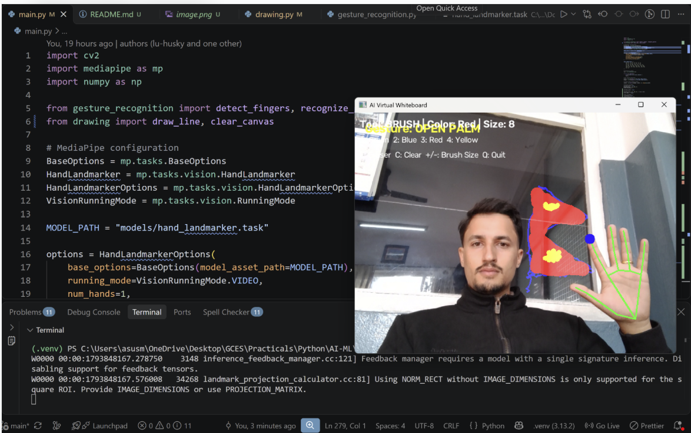

# AI Virtual Whiteboard

An interactive, hand-gesture-controlled virtual whiteboard built with **Python, OpenCV, MediaPipe, and NumPy**.

The project uses computer vision and hand landmark detection to track hand movements through a webcam. Users can draw on a virtual canvas using their index finger and control the whiteboard using hand gestures and keyboard shortcuts.

## Features

### Implemented

- **Real-time hand tracking:** Detects and tracks hand landmarks using MediaPipe.
- **Finger detection:** Identifies whether the index, middle, ring, and pinky fingers are raised or folded.
- **Gesture recognition:** Recognizes specific hand gestures using rule-based logic.
- **Virtual drawing:** Draws continuous lines by tracking the index fingertip.
- **Drawing pause:** Uses a two-finger gesture to pause drawing.
- **Multiple colors:** Supports green, blue, red, and yellow.
- **Eraser:** Removes existing strokes.
- **Clear canvas:** Clears the entire drawing canvas.
- **Adjustable brush size:** Increases or decreases drawing thickness.

### Planned Features

- Gesture-based color selection.
- Gesture-based eraser and canvas controls.
- On-screen interactive toolbar.
- Save whiteboard drawings as image files.
- Air writing and handwritten character recognition.
- Voice-controlled whiteboard commands.

## Technologies Used

| Technology | Purpose                                      |
| ---------- | -------------------------------------------- |
| Python     | Main programming language                    |
| OpenCV     | Webcam access, image processing, and drawing |
| MediaPipe  | Hand landmark detection and tracking         |
| NumPy      | Canvas creation and array operations         |

## Project Structure

```text
ai-virtual-whiteboard/
│
├── main.py
├── hand_tracking.py
├── gesture_recognition.py
├── drawing.py
│
├── models/
│   └── hand_landmarker.task
│
├── assets/
├── output/
│
├── requirements.txt
└── README.md
```

### File Descriptions

| File / Directory         | Description                                                                           |
| ------------------------ | ------------------------------------------------------------------------------------- |
| `main.py`                | Main application; integrates webcam, hand tracking, gesture recognition, and drawing. |
| `hand_tracking.py`       | Handles hand landmark detection using MediaPipe.                                      |
| `gesture_recognition.py` | Detects finger states and recognizes hand gestures.                                   |
| `drawing.py`             | Contains drawing and canvas-clearing functions.                                       |
| `models/`                | Stores the MediaPipe hand landmark model.                                             |
| `assets/`                | Stores project resources.                                                             |
| `output/`                | Stores generated whiteboard images.                                                   |
| `requirements.txt`       | Lists Python dependencies.                                                            |

## ⚙️ Installation and Setup

### 1. Clone the repository

```bash
git clone https://github.com/ad-abhishek/ai-virtual-whiteboard.git

cd ai-virtual-whiteboard
```

### 2. Create a virtual environment

```bash
python -m venv venv
```

Activate it on Windows PowerShell:

```powershell
.\venv\Scripts\Activate.ps1
```

### 3. Install dependencies

```bash
pip install -r requirements.txt
```

### 4. Download the MediaPipe model

Download the Hand Landmarker model from:

[Download hand_landmarker.task](https://storage.googleapis.com/mediapipe-models/hand_landmarker/hand_landmarker/float16/1/hand_landmarker.task)

Place the downloaded file inside the `models/` directory:

```text
models/
└── hand_landmarker.task
```

### 5. Run the application

```bash
python main.py
```

Make sure your webcam is connected and accessible.

## Dependencies

The project uses the following Python libraries:

```text
opencv-python
mediapipe
numpy
```

You can install them individually:

```bash
pip install opencv-python mediapipe numpy
```

Or generate your own requirements file:

```bash
pip freeze > requirements.txt
```

## Hand Gestures

The project uses MediaPipe to detect 21 hand landmarks.

The finger detection logic checks the vertical positions of the fingertips and their corresponding middle joints (PIP landmarks).

| Gesture           | Finger Configuration | Action             |
| ----------------- | -------------------- | ------------------ |
| ☝️ Index finger   | `[1, 0, 0, 0]`       | Draw               |
| ✌️ Index + middle | `[1, 1, 0, 0]`       | Pause drawing      |
| ✊ Fist           | `[0, 0, 0, 0]`       | Recognized gesture |
| 🖐️ Open fingers   | `[1, 1, 1, 1]`       | Recognized gesture |

**Note:** The finger configuration represents `[index, middle, ring, pinky]`. The current basic detector does not include the thumb.

## Keyboard Controls

| Key       | Action              |
| --------- | ------------------- |
| `1`       | Select green        |
| `2`       | Select blue         |
| `3`       | Select red          |
| `4`       | Select yellow       |
| `E`       | Toggle eraser       |
| `C`       | Clear canvas        |
| `+` / `=` | Increase brush size |
| `-` / `_` | Decrease brush size |
| `Q`       | Quit application    |

The OpenCV window must be active to receive keyboard input.

## Concepts Learned

This project is also a practical learning exercise in computer vision and AI/ML.

Some important concepts explored:

- Webcam capture using `cv2.VideoCapture()`.
- Image processing and color-space conversion (BGR to RGB).
- Real-time video processing.
- Hand landmark detection using MediaPipe Tasks.
- Normalized coordinates and pixel-coordinate conversion.
- Rule-based gesture recognition.
- NumPy arrays and image canvases.
- Drawing with OpenCV functions such as `cv2.line()`.
- Combining image frames using `cv2.add()`.
- Modular Python programming and separating responsibilities across files.

## How It Works

The application follows this general workflow:

```text
Webcam Input
     |
     v
Capture Video Frame
     |
     v
Convert BGR to RGB
     |
     v
MediaPipe Hand Detection
     |
     v
Extract 21 Hand Landmarks
     |
     v
Detect Finger Positions
     |
     v
Recognize Hand Gesture
     |
     v
Determine Drawing Action
     |
     v
Update Virtual Canvas
     |
     v
Combine Canvas with Webcam Frame
     |
     v
Display Output
```

### Important Implementation Details

**1. Hand Landmark Detection**

MediaPipe detects 21 landmarks on a hand. Each landmark contains normalized `x`, `y`, and `z` coordinates.

The normalized coordinates are converted into screen coordinates:

```python
x = int(landmark.x * width)
y = int(landmark.y * height)
```

**2. Gesture Recognition**

The application uses landmark positions to determine which fingers are raised.

For example, the index finger is considered raised when its fingertip is above its PIP joint:

```python
if hand_landmarks[8].y < hand_landmarks[6].y:
    # Index finger is raised
```

**3. Continuous Drawing**

The application stores the previous index fingertip position and connects it to the current position:

```python
cv2.line(canvas, previous_point, current_point, color, thickness)
```

This creates continuous drawing strokes rather than isolated points.

**4. Virtual Canvas**

A NumPy array is used to create a blank canvas:

```python
canvas = np.zeros((height, width, 3), dtype=np.uint8)
```

The canvas is combined with the webcam frame:

```python
output = cv2.add(frame, canvas)
```

## Current Limitations

- Gesture recognition relies on simple landmark-position rules and may be affected by hand orientation.
- Drawing performance depends on webcam quality, lighting, and tracking stability.
- The current finger detector does not evaluate thumb position.
- Keyboard shortcuts are used for some whiteboard controls.
- Handwriting recognition and voice commands are not yet implemented.

## Future Improvements

The long-term goal is to transform this project into a more intelligent, interactive whiteboard.

Possible improvements include:

1. Implementing more robust gesture recognition.
2. Adding a fully gesture-controlled toolbar.
3. Integrating handwritten digit and character recognition.
4. Exploring machine learning models for handwriting recognition.
5. Adding voice commands.
6. Saving and managing multiple whiteboard sessions.
7. Improving drawing smoothness with coordinate smoothing.

## Author

**Abhishek Adhikari**

Software Engineer | Full-Stack Development | AI/ML Enthusiast

- GitHub: [Ad-Abhishek](https://github.com/Ad-Abhishek)

---

_Built as a hands-on learning project to explore computer vision, hand tracking, gesture recognition, and practical AI applications using Python._
